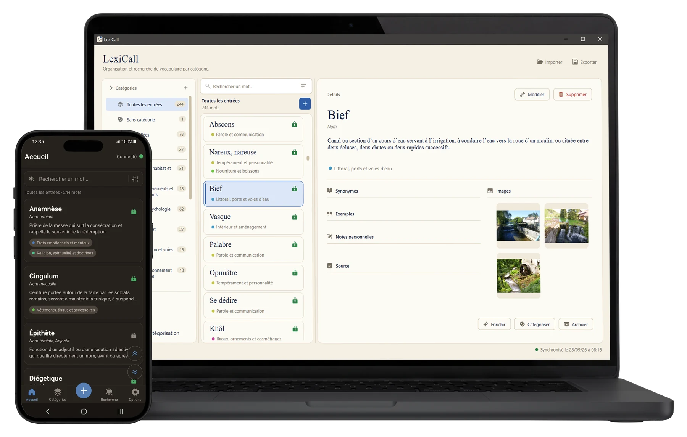
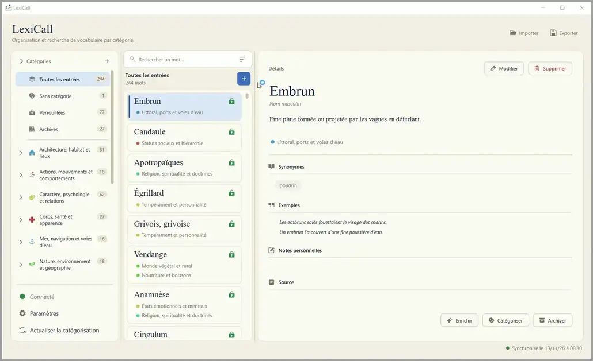
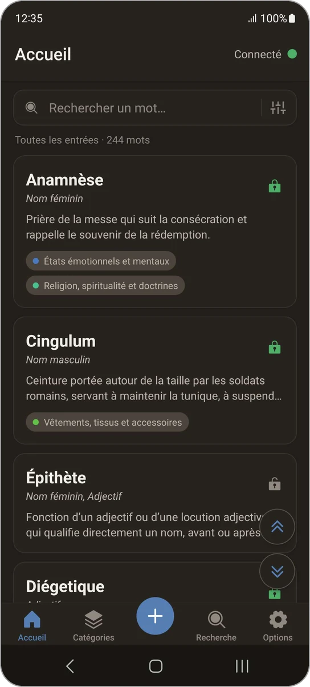
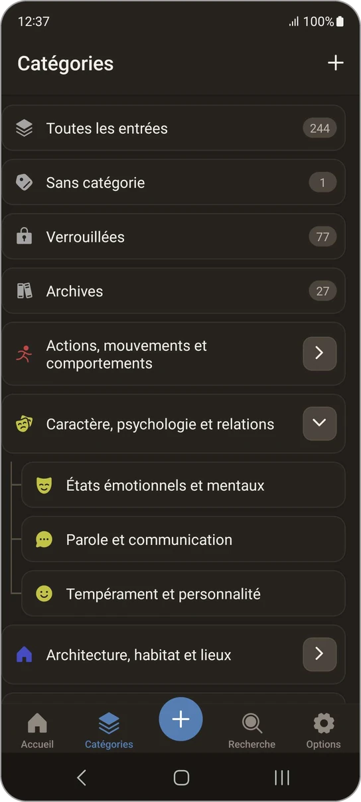
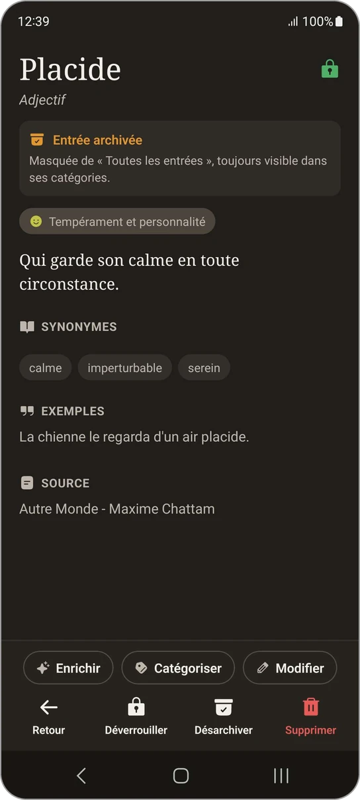
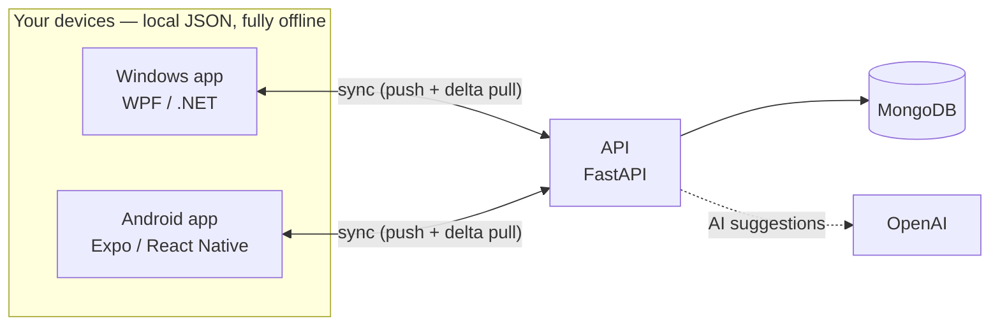

<!-- Public landing page: what LexiCall is, how to run it in minutes, and why it is built this way. -->
<p align="center">
  
</p>

<h1 align="center">LexiCall</h1>

<p align="center">
  Collect the words you meet while reading — filed by category, enriched by AI you review, synced across your devices, and always available offline.
</p>

<p align="center">
  
</p>

<p align="center">
  <a href="#highlights">Highlights</a> ·
  <a href="#quick-start">Quick start</a> ·
  <a href="#why-these-choices">Why these choices</a> ·
  <a href="#repository">Repository</a>
</p>

## What it does

LexiCall is a personal vocabulary tracker for the words and expressions you collect while reading. Each entry holds one or several senses, grammatical types, synonyms, example sentences, notes, a source and up to four images. Entries are filed in a nested category tree and found again with an instant, accent-insensitive search.

Everything is stored on your device, so the Windows and Android apps behave the same with or without a connection. An optional backend keeps your devices in sync and powers the AI features — which only ever *suggest*: you review and accept each field yourself.

> **Built for French vocabulary.** The interface, the AI prompts and the screenshots below are in French.

## Highlights

- **Organized your way** : nested categories with 700+ vector icons, an automatic color per category (overridable), live counters, and virtual views for uncategorized, locked and archived entries.
- **Rich entries** : several senses and grammatical types per word, synonyms, examples, personal notes, a source, and up to four captioned images.
- **AI that proposes, you decide** : one click drafts the definition, type, synonyms and examples; another suggests the right category. Each suggestion goes through a review dialog where you accept or skip it field by field, and locked fields are never touched.
- **Instant search** : accent-insensitive, in memory, no index to maintain.
- **Offline-first sync** : edits are saved locally first and pushed in the background; the most recent edit wins, and a history view shows exactly what was sent or received.
- **Two clients, one collection** : a native Windows app and an Android app, both with light and dark themes and JSON import/export.

<br>

<p align="center">
  
  <br>
  <sub><i>Windows client: Add a word, review the AI's draft field by field, let it suggest a category, and watch the entry sync.</i></sub>
</p>

<br>

<p align="center">
  
  
  
  <br>
  <sub><i>Android client: home, categories, entry.</i></sub>
</p>

## Quick start

The Windows app needs nothing but itself; the backend and the phone app are optional extras.

### 1. Windows app

Requires Windows 10/11 and the [.NET 10 SDK](https://dotnet.microsoft.com/download/dotnet/10.0).

```powershell
git clone https://github.com/ArenKae/LexiCall.git
cd LexiCall/apps/windows
dotnet run --project src/LexiCall.Desktop.csproj
```

The app starts empty and works fully offline: press **+** to add your first word. With [`just`](https://github.com/casey/just) installed, `just run-win` from the repo root does the same.

### 2. Backend (optional — enables sync and AI)

Requires Python 3.12, Docker and [`just`](https://github.com/casey/just), on Linux, macOS or WSL.

```bash
cp api/.env.example api/.env     # then set API_KEY
just install                     # virtualenv + dependencies
just start                       # MongoDB in Docker, then the API on http://localhost:8000
```

Interactive docs are at `/docs`. In the Windows app, open **Paramètres**, enter the API URL and your `API_KEY`, then press **Tester la connexion**; the app syncs in the background from then on.

The AI features need an OpenAI key: set `OPENAI_API_KEY` in `api/.env` before starting.

### 3. Android app (optional)

Requires Node 20 and an Android phone or emulator.

```bash
cd apps/android
npm install
npm run dev:android
```

This starts the Expo dev server and opens the app on the connected device or emulator. Then open the **Options** tab, enter the API URL and key, and sync. From an emulator, the host's `localhost` is `http://10.0.2.2:8000`; from a USB-connected phone, run `adb reverse tcp:8000 tcp:8000` and use `http://localhost:8000`.

## Why these choices



| Choice | Why |
| --- | --- |
| **Local JSON file as the source of truth** | Zero moving parts, offline by design, readable by hand. A personal vocabulary fits in memory, so no database engine on the client. |
| **A backend the apps never depend on** | Sync is best-effort: losing the network, or the server, never blocks reading or editing a word. |
| **Last-Write-Wins with conditional writes** | A late or replayed push can never overwrite a newer edit, and there is no merge screen to build or explain. |
| **Soft deletes and delta pulls** | Deletions reach every device, and a sync costs what changed, not the size of the collection. |
| **FastAPI and MongoDB** | A small typed API whose documents mirror the JSON the clients already hold, with TTL indexes to clean up deletions. |
| **AI behind the API, as suggestions** | The OpenAI key never reaches a client, every suggestion is reviewed field by field, and words the model cannot confirm are rejected instead of invented. |
| **Embeddings first, LLM second** | Retrieval narrows the candidate categories, so categorization stays around $0.0004 per word however large the vocabulary grows, and an invented category id is structurally impossible. |
| **WPF on .NET 10 for the desktop** | A fast, native, dependency-light Windows app — the daily driver. |
| **Expo / React Native for Android** | One JavaScript codebase that mirrors the desktop data model, with plain JSON persistence instead of SQLite. |


Each README below goes into the details.

## Repository

```text
apps/windows/   WPF / .NET desktop client
apps/android/   Expo / React Native client
api/            FastAPI + MongoDB backend
assets/         README media
```

| | |
| --- | --- |
| [`apps/windows`](apps/windows/README.md) | Features, build and publish, local data, sync client, code layout |
| [`apps/android`](apps/android/README.md) | Features, run and build, navigation, sync, image caching |
| [`api`](api/README.md) | Endpoints, sync protocol, AI enrichment, configuration, deployment |

Day-to-day commands go through [`just`](https://github.com/casey/just) from the repo root — `just --list` shows them all (`run-win`, `start-android`, `start` for the API with hot reload, …).