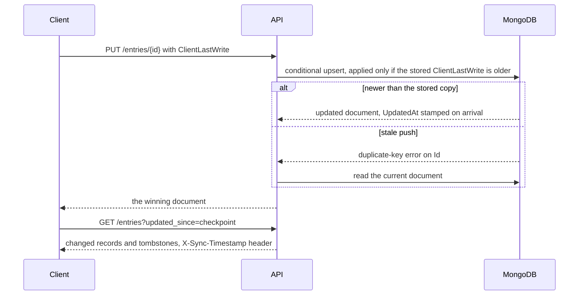

<!-- Backend API: setup, configuration, endpoints, sync protocol, AI enrichment and deployment. -->
# LexiCall — API

FastAPI + MongoDB backend. It is the sync hub between the [Windows](../apps/windows/README.md) and [Android](../apps/android/README.md) clients, and the only place the AI features run: the OpenAI key never leaves this service. The clients stay fully usable without it — see the [root README](../README.md) for the big picture.

## Quick start

### Development (Linux, macOS, WSL)

Needs Python 3.12, Docker and [`just`](https://github.com/casey/just). From the repo root:

```bash
cp api/.env.example api/.env      # then set API_KEY (the file explains how to generate one)
just install                      # virtualenv + dependencies
just start                        # Mongo in Docker, then uvicorn --reload on 0.0.0.0:8000
just stop                         # stop the dev stack
```

The API listens on `http://localhost:8000` (interactive docs at `/docs`). Check it with `curl http://localhost:8000/health`, which answers `{"status": "ok", "mongo": "ok"}`.

From `api/` the same recipes are called `dev-install`, `dev-up`, `dev-run` and `dev-stop`. The recipes are bash scripts, so on Windows run them from WSL.

## Configuration

Read from environment variables, or from `.env` when running uvicorn on the host.

| Variable | Default | Purpose |
| --- | --- | --- |
| `API_KEY` | required | Shared secret expected in the `X-API-Key` header |
| `MONGO_URI` | `mongodb://localhost:27017` | MongoDB connection string; in production, a user scoped to this one database |
| `MONGO_DB_NAME` | `lexicall` | Database name |
| `MAX_IMAGE_BYTES` | `2000000` | Largest accepted image, once decoded |
| `OPENAI_API_KEY` | empty | Enables the AI routes; without it they answer `502` and everything else keeps working |

## Authentication

Every route except `/`, `/health` and the interactive docs needs an `X-API-Key` header, compared in constant time (`401` otherwise). It is single-user by design: one shared key, no accounts, no sessions. `GET /auth` is a dedicated connectivity check — it validates the key without touching Mongo — used by the clients' connection test and before every sync cycle.

## Endpoints

| Route | Purpose |
| --- | --- |
| `GET /`, `GET /health`, `GET /auth` | Service identity, MongoDB health, authenticated connectivity check |
| `GET /entries`, `PUT /entries/{id}`, `DELETE /entries/{id}`, `GET /entries/{id}` | Entries — `PUT` is an upsert, there is no `POST` |
| `GET /entries/{id}/images/{image_id}` | One entry image, as raw JPEG |
| `GET /categories`, `PUT`/`DELETE`/`GET /categories/{id}` | Categories |
| `POST /categories/reindex-embeddings` | Rebuild the category embeddings |
| `POST /enrichment/fields`, `/enrichment/rephrase-definition` | AI field suggestions, definition rephrasing |
| `POST /enrichment/category-candidates`, `/enrichment/categorize` | Embedding retrieval, and the categorization decision on top of it |
| `GET /wiktionary/{word}` | Raw French Wiktionary wikitext for a word |

Records use PascalCase field names that match the clients' own models, so there is no translation layer; the AI routes answer in snake_case (`word_recognized`, `justification`, …). Field names are case-sensitive: a client that serializes camelCase silently gets default values rather than a validation error.

## Sync protocol

Clients work offline and catch up whenever a connection shows up, without either side having to guess what it missed. Re-sending the whole dataset on every catch-up would be several hundred sequential requests at every startup, so the protocol is built from a few small mechanisms.



**Two timestamps per record.** `ClientLastWrite` is stamped by the client when the user edits something; it is the Last-Write-Wins arbiter. `UpdatedAt` is stamped by the server when a write *arrives*; it is the pull cursor, never exposed to the clients. They are separate because an edit made offline and pushed late must still reach devices that already pulled past its edit time, and a queued deletion keeps its original time for the race but must reach everyone who pulled since.

**Conditional upsert.** `PUT /entries/{id}` and `PUT /categories/{id}` are the only write routes. Each is one `find_one_and_update(..., upsert=True)` filtered on `ClientLastWrite` being older than the incoming value, so a fresh insert and a winning update go through the same call and the create-or-update decision never leaves the server. A push that loses the comparison matches nothing, so the upsert tries an insert and collides with the unique index on `Id`; that duplicate-key error is how a stale push is told apart from a creation, and it is handled as a normal outcome — the response is the current winning document, not an error. `CreatedAt` and `IsDeleted` are written only on insert (`$setOnInsert`), so an ordinary edit cannot clobber them. The comparison is lexicographic on ISO-8601 strings, which is safe because every timestamp is normalized to UTC with fixed precision before it is stored or compared.

**Soft deletes.** `DELETE` is the same conditional write with a different `$set`: `IsDeleted: true`, `ClientLastWrite` taken from `?deleted_at=`, a fresh `UpdatedAt`, and `TombstonedAt` (a real BSON date) so a TTL index purges the tombstone 30 days later. It is never an upsert — an unknown id is a `404`, and clients treat that as success. A hard delete would leave nothing for another device to learn the deletion from; the tombstone is the channel. A tombstoned id stays unusable for a new live record until it is purged, and a client offline for more than 30 days can miss a deletion. Deleting a category is refused with `409` while it has subcategories or is still referenced by an entry.

**Delta pulls.** `GET /entries` and `GET /categories` return the live records, tombstones excluded. With `updated_since` they return everything whose `UpdatedAt` is newer — tombstones included — sorted by `UpdatedAt`. Every response carries an `X-Sync-Timestamp` header captured *before* the query runs, so a write landing in between is picked up on the next pull. The client persists that value verbatim as its next `updated_since` instead of trusting its own clock for anything that decides what gets fetched.

How clients use these routes — per-record dirty tracking, push ordering, the 60-second timer, the operation log — is described in the [Windows](../apps/windows/README.md#sync-client) and [Android](../apps/android/README.md#sync) READMEs.

## Entry images

Images are not stored on the entry: they live in the `entry_images` collection, one document per image id, up to four per entry. A Mongo projection that excludes a field only saves bandwidth, not server-side cache pressure — WiredTiger still pages the whole document, image bytes included, for any scan. Keeping images inline made browsing `entries` slower as it grew, whatever the projection.

`PUT /entries/{id}` carries the image bytes alongside the entry's own fields. Each image is decoded and size-checked (`400` for invalid base64, `413` above `MAX_IMAGE_BYTES`) before anything is written, and the per-image upsert or delete is skipped entirely when the entry's own write loses the Last-Write-Wins race, so a stale push cannot clobber newer images. There is no standalone image write route: two requests can never race to set the same image, and one request per entry mutation means no follow-up call that could fail independently. Deleting an entry deletes its images.

Reading is `GET /entries/{entry_id}/images/{image_id}`, raw bytes as `image/jpeg` (the image is looked up by its own id; `entry_id` only shapes the path). Entry listings carry image metadata only, so clients fetch bytes one image at a time when an entry is displayed and cache them under the image id.

## AI enrichment

All of it goes through the OpenAI Responses API (`gpt-5.6-luna`, low reasoning effort by default) with strict structured outputs, plus `text-embedding-3-small` for embeddings. The prompts and the schemas are in French: the features are built for French vocabulary. A missing key, a refused key, a rate limit, a timeout or a Wiktionary failure each become a `502` with a specific message instead of a generic `500`.

Every enrichment and categorization response carries `word_recognized`. When the model cannot confirm that the word is a real, attested French word or expression — random characters, an invented word, an unconfirmed typo — it is `false`, every other field is absent, and the model is told never to fall back on a similar-looking real word.

### Field suggestions

`POST /enrichment/fields` proposes a definition, types, synonyms and examples. The request carries the field values themselves rather than an entry id, because the main use is enriching a word that is still being typed and has no server-side record.

1. **Grounding.** The French Wiktionary entry is fetched first (alternate spellings and a near-match search as fallbacks, trimmed to the French section, keeping synonyms and at most three literary citations). If there is none, one web-search call decides whether the word exists and writes a factual brief.
2. **Fan-out.** The unlocked fields are split into up to three concurrent calls — definition; type; synonyms and examples — each carrying only its own rules. A failed call just leaves its field unsuggested; the request fails only if every call does.
3. **Conservative by default.** An empty field always gets a proposal; a non-empty one is touched only when there is a real gap (a typo, missing punctuation, an obviously absent sense), with a short justification.

A field listed in `LockedFields` is excluded structurally: it never appears in the model request, neither in the prompt nor in the output schema.

`Definition` is a list with one element per distinct sense. `Type` is a list at the entry level, capped at two because an extra slot gets filled whether or not it is warranted; `["Undefined"]` stands for an untyped entry and never coexists with a real type. `Nom` sits next to `Nom masculin` and `Nom féminin` for nouns used in both genders.

`POST /enrichment/rephrase-definition` takes `{Word, Definition}` and returns another phrasing of the same meaning — no Wiktionary lookup, no web search, no sufficiency judgment, so it is far cheaper than the field suggestions. It is stateless: the caller must always send the original definition, never the output of a previous rephrase, so repeated calls cannot drift.

### Categorization

Categorization is retrieval first, decision second.

- **Retrieval.** `POST /enrichment/category-candidates` takes `{Word, Definition?}` and an optional `k` (default 6) and returns the closest categories. Each sense is vectorized and ranked separately, then the per-sense top-k are merged: one vector for a word with two unrelated meanings lands between the two and surfaces neither. Sending the definition is strongly worth it — a bare rare word is close to noise for an embedding model. Scores are only meaningful relative to each other, never as an absolute threshold, and an empty list means nothing has been indexed yet, not that nothing matched.
- **Decision.** `POST /enrichment/categorize` asks the model to choose among the top candidates *plus every root category* — the top-k keeps the token cost flat as the vocabulary grows, and the roots let it propose a new category under a sensible parent even when similarity never surfaced that branch. Category ids in its answer are constrained to an enum of the ids actually shown in the prompt, so an invented id is structurally impossible. It answers with up to three suggestions, each `existing` or `new` with its own justification; more than one only when the word carries distinct senses in different lexical fields. The cap is applied server-side because a schema-level `maxItems` makes the model cram what it can no longer add into the last element. Duplicates and self-contradicting entries are dropped, and losing *all* of them is a `502` rather than a silent "nothing fits". A call costs about $0.0004 and takes around 3.7 seconds, dominated by the decision; retrieval is one embeddings call plus local math.

### Category embeddings

Vectors live in their own `category_embeddings` collection, one per category, so that `categories` — which every client pulls on every sync — stays free of bulky fields. The text embedded for a category is its hierarchical path, the nearest description available (its own, else the closest ancestor's), and the words actually filed under it, alphabetically and capped at 100: a category's name says what it is called, not what it ended up holding, and adding the member words raised similarity scores by 20–25% on a real 42-category corpus.

A category write re-embeds that category and its descendants, only when the embedded text actually changed, and on a best-effort basis. Entry writes deliberately do not trigger any re-embedding — it would mean an embeddings call per entry during a full sync — so category vectors can lag behind their membership. `POST /categories/reindex-embeddings` reconciles everything in one idempotent pass (re-embed what drifted, drop vectors whose category is gone) and returns `{embedded, unchanged, orphans_removed}`. It costs nothing when everything is current, and both clients expose it as an action.

## Data model

| Collection | Holds | Indexes |
| --- | --- | --- |
| `entries` | Vocabulary entries, tombstones included | unique `Id`; `UpdatedAt` (delta pulls); TTL on `TombstonedAt` (30 days) |
| `categories` | Categories, tombstones included | unique `Id`; `UpdatedAt`; TTL on `TombstonedAt` (30 days) |
| `entry_images` | One document per image | unique `Id` |
| `category_embeddings` | One vector per category | unique `Id` |

Records are keyed by an application `Id` generated by the client, never by Mongo's `_id`. An entry references its categories by id, never by name.

## Code layout

```text
src/
├── main.py                    app assembly, /, /health, /auth, index creation at startup
├── config.py, security.py     settings, API key check
├── database.py, timestamps.py Mongo access and indexes, ISO-8601 UTC normalization
├── models/                    Pydantic models, PascalCase aliases
├── repositories/              one module per collection (conditional writes live here)
├── routers/                   entries, categories, entry_images, enrichment, wiktionary
└── enrichment.py, embeddings.py, category_indexing.py, llm_client.py, wiktionary_client.py
```

## Deployment

`docker-compose.prod.yml` deploys the API only. MongoDB is a shared instance owned and operated outside this repository: the `api` service reaches it over an external Docker network, `lexicall-db`, which must exist before `docker compose up`. Nothing here creates, starts, stops or owns that network, the Mongo container or its data volume, so `just deploy` and `just down` can never touch the database. `MONGO_URI` in `.env` points at a scoped user — `readWrite` on this application's database only, never a root account (see `.env.example`). The API is published on `127.0.0.1:8001` for a reverse proxy to terminate TLS in front of it.

```bash
just deploy      # build if needed and bring the API up; safe to rerun after every git pull
just down        # stop it
just backup      # deploy/backup.sh
just mongosh     # interactive shell as the scoped app user
```

`deploy/backup.sh` mirrors the same scoping: it dumps only this application's database, with the same credentials, from a disposable container on the `lexicall-db` network. A push to the `prod` branch triggers `.github/workflows/deploy.yml`, which connects to the server over SSH and runs a forced command; changes under `apps/` never redeploy the API on their own. The server's own setup is not recorded in this repository.

## Debugging the AI routes

There is no automated test suite: changes are checked by hand against a dev server. Two scripts under `tests/` drive the AI features directly and print every request, intermediate result and cost estimate. Run them from `api/`:

```bash
PYTHONPATH=src .venv/bin/python tests/debug_enrichment.py <word> [--locked Field1,Field2]
PYTHONPATH=src .venv/bin/python tests/debug_categorization.py <word> [--definition "..."] [-k N] [--retrieval-only]
```

The categorization script shows the query text, the ranked candidates with their scores, the roots joined to the prompt, the closed id enums and the raw model output before resolution; `--retrieval-only` stops before the paid model call.
