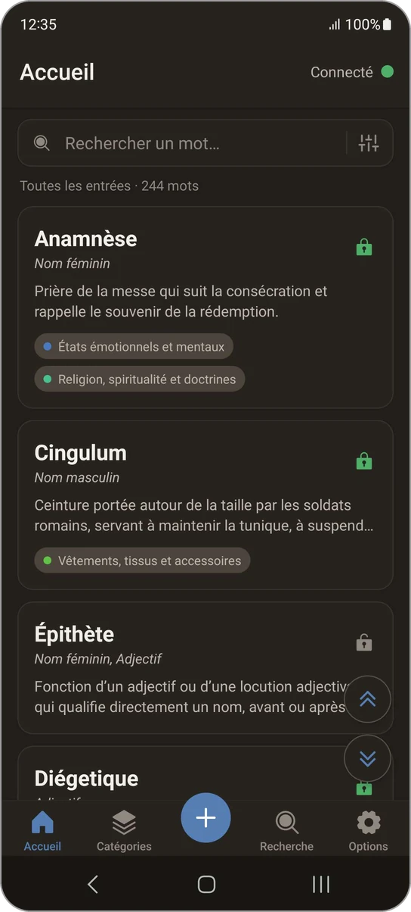
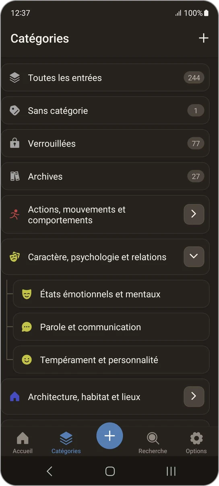
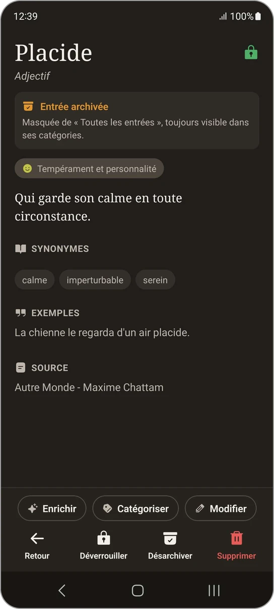

<!-- Android client: features, run and build, project layout, navigation, sync and image caching. -->
# LexiCall — Android

React Native + Expo client for the same vocabulary collection as the [Windows app](../windows/README.md): same data model, same sync protocol, same AI features. The interface is in French.

<p align="center">
  
  
  
</p>

## Features

- **Home** — entry list with accent-insensitive search, a filter sheet (sort order and active category), scroll-to-edge buttons, and cards showing the word, its types, the first sense and its categories.
- **Categories** — collapsible tree with counters, icons and colors, plus virtual views for all, uncategorized, locked and archived entries. A long press opens the actions for a category: add a subcategory, move up or down, edit, delete.
- **Search** — a dedicated tab searching words and categories.
- **Entry detail** — numbered senses, categories, synonyms, examples, notes, source, images with a full-screen viewer. Actions: enrich, categorize, edit, lock, archive, delete.
- **Editing** — one form for creating and editing: word, several types, several senses, categories, synonyms, examples, notes, source, up to four captioned images picked from the gallery, and per-field locks. Categories have their own editor with a parent picker (cycles excluded), an icon picker with keyword search and a color picker.
- **AI** — **Enrichir** and **Catégoriser** open review modals where each suggestion is accepted or skipped field by field. From the detail screen they apply immediately; from the editor they apply to the draft and nothing is saved until you confirm.
- **Sync** — a status indicator in every header, a sync history screen, and in **Options**: connection test, sync now, full resync, category embeddings refresh, database export and import.
- **Theme** — light or dark, following the system setting.

## Run

Requires Node 20 (see `.nvmrc`) and an Android phone or emulator.

```bash
cd apps/android
npm install
npm run dev:android
```

This starts the Expo dev server and opens the app on the connected device or emulator, through Expo Go or a development build. From the repo root: `just install-android`, then `just start-android`.

`dev:android` is deliberately not called `android`: `expo prebuild` rewrites the `android` script to `expo run:android` on every run, which would silently turn the start recipe into a slow native build.

### Connecting to an API

Open the **Options** tab, enter the API URL and key, and sync.

| Where the app runs | URL for an API on your machine (`localhost:8000`) |
| --- | --- |
| Emulator | `http://10.0.2.2:8000` |
| USB phone | run `adb reverse tcp:8000 tcp:8000`, then `http://localhost:8000` |
| Phone on the same network | `http://<your-lan-ip>:8000` (the dev server binds `0.0.0.0`) |

Android blocks plain-HTTP traffic in release builds, so an installed APK needs an HTTPS API URL; plain HTTP is fine against the dev server. Changing the API URL discards the sync state built against the previous server and starts over.

### Release APK

`just apk` prebuilds the native project and builds a release APK at `apps/android/android/app/build/outputs/apk/release/app-release.apk`. It is the maintainer's recipe: it expects Android Studio's JDK at `/opt/android-studio/jbr` and copies the result to a VM shared folder (`/mnt/hgfs/Shared`). On another machine, run the two build steps yourself:

```bash
npx expo prebuild --platform android
cd android && ./gradlew assembleRelease
```

## Stack

JavaScript (no TypeScript) on Expo SDK 57 / React Native 0.86 / React 19, with Expo Router for file-based routing, Zustand for state, `react-native-svg` for icons, `expo-file-system` for persistence, and `expo-image-picker` / `expo-image-manipulator` for images. `.npmrc` sets `legacy-peer-deps` because Expo's bundled web tooling declares a `react-dom` peer range that does not match its own React; the project never targets the web.

## Project layout

```text
app/                    Expo Router routes
├── (tabs)/             bottom tabs: index (home), categories, search, options; create opens the editor
├── entry/              [id].js (detail), edit.js (create and edit)
├── category/edit.js    category editor
├── sync-history.js
└── _layout.js
src/
├── components/         cards, review modals, pickers, sheets
├── hooks/              auto sync, image loading, scroll edges
├── models/             normalization of records received from the API or a local file
├── services/           API client, local storage, image cache, sync history
├── store/              Zustand store, sync cycle, pull merge
├── theme/              colors, theme hook, generated icons
└── utils/              search, filtering, hierarchy, timestamps, text parsing, image processing
scripts/                generate-icons.mjs
assets/                 app icon and splash
```

## Design notes

### Navigation

A bottom tab bar holds every top-level destination, and the **+** in the middle opens the editor. There is deliberately no floating action button: any global action belongs in the bar. `(tabs)` is an Expo Router *route group* — it groups screens without adding a URL segment, so the routes are `/` and `/categories`, not `/tabs/...`.

### Local-first persistence

Each concern is one JSON file under the app's document directory, written through `expo-file-system`: `vocabulary.json`, `settings.json` and `sync_history.json`. The screens read only from the Zustand store hydrated from those files; a pull merges into the local copy, and the UI never reads the API directly. At a few hundred entries there is no reason to bring in SQLite — an in-memory scan is the same choice the desktop client makes.

### Sync

The protocol is the one the Windows client speaks, described in the [API README](../../api/README.md#sync-protocol). One cycle:

1. test the connection first — if the server is unreachable, nothing else is attempted;
2. retry pending deletions, entries before categories;
3. push every record whose `SyncedAt` is missing or older than its `ClientLastWrite`, categories before entries;
4. delta-pull categories, then entries, and merge. The checkpoint comes from the *categories* pull — the older of the two tokens — because taking the entries one would permanently skip a category written between the two requests.

A cycle runs once the database is loaded, every 60 seconds, and whenever the app returns to the foreground. The foreground trigger carries most of the weight: the interval is throttled or suspended while the app sits in the background.

### Timestamps

Two rules keep Last-Write-Wins correct across clients:

- **Never compare timestamps as strings.** Formats differ (`Z` versus `+00:00`; three, six or seven fractional digits), so lexicographic order says nothing. Always parse first — `isNewer` in `src/utils/timestamps.js`.
- **Never rewrite a timestamp received from the server.** It is stored verbatim. JavaScript can only produce three decimals, so reformatting would make it look older than the stored value. A timestamp is generated only when the user changes something locally; the server normalizes whatever it receives, so sending the three-decimal form is safe.

### Images

A pull carries image metadata only. Bytes are fetched on demand when an entry is opened, through `GET /entries/{id}/images/{image_id}`, and cached under the app's cache directory as `<image id>.jpg`. An image id is never reused for different bytes, so the cache never needs invalidating, and the UI tolerates an empty `ImageBase64` as the normal state after a pull. Picked images are downscaled to 1024 px on the longest side and compressed to JPEG quality 80 before being attached.

### Icons

The 735 category icons come from the desktop client's generated resources: `node scripts/generate-icons.mjs` (run from `apps/android`) rewrites `src/theme/icons.js` and `src/theme/iconCatalog.js` from `apps/windows/src/Themes/Icons.Generated.xaml`, so both clients draw the same set. They add roughly 500 KB of static path data to the bundle.

### Local-only preferences

Manual category colors and sibling order, the visibility of the virtual categories, and the API settings live in `settings.json` and are never synced: two devices can legitimately show a category differently.
