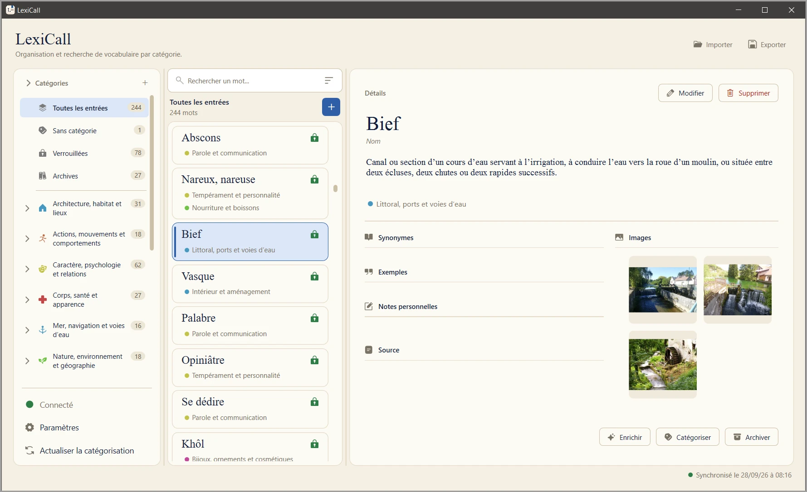

<!-- Windows desktop client: features, build and run, local data, sync client and code layout. -->
# LexiCall — Windows

WPF / .NET 10 desktop client, and the main place where vocabulary gets collected. It runs fully on its own; syncing with the [API](../../api/README.md) is optional. The interface is in French.

<p align="center">
  
</p>

## Features

- **Three-pane window** — category tree, filtered entry list and entry detail, separated by splitters so long category names are handled by resizing rather than truncation.
- **Entries** — several senses (one row each, never below one), several grammatical types, synonyms, examples, notes, a source, archiving, and up to four captioned images (downscaled to 1024 px and JPEG quality 80 before they are stored).
- **Locks** — each enrichable field (definition, type, synonyms, examples) can be locked so that AI suggestions never touch it. An entry with every field locked counts as *locked* and shows up under **Verrouillées**.
- **Categories** — nested (cycles refused), deletion refused while a category has children or entries, 735 vector icons in 21 keyword-searchable groups, an automatic color per category with a manual override, and manual order among siblings.
- **Virtual views** — all entries, uncategorized, locked and archived. An archived entry is hidden from the first three but stays visible under its real categories.
- **Search and sort** — accent-insensitive in-memory search; newest first or alphabetical.
- **AI** — **Enrichir** drafts definition, type, synonyms and examples, **Reformuler** rewrites one definition, **Catégoriser** suggests existing or new categories. Results open in review dialogs where each field is applied or skipped individually.
- **Sync** — background push and delta pull, a connection indicator in the sidebar, and a history window listing every operation.
- **Also** — light and dark themes, JSON import and export, window position restored per monitor.

## Run and build

Requires Windows 10/11 and the .NET 10 SDK (10.0.301 or later, pinned in `global.json`).

```powershell
cd apps/windows
dotnet restore
dotnet build LexiCall.sln
dotnet run --project src/LexiCall.Desktop.csproj
```

Run these from `apps/windows`: .NET resolves the SDK version by walking *up* from the current directory, so `global.json` is ignored from the repo root. The folder holds a solution and, one level down, a project — pass the file explicitly.

From the repo root, `just` wraps the same steps:

| Recipe | Does |
| --- | --- |
| `just run-win` | Run in debug mode |
| `just build-win` | Build in debug mode |
| `just launch-win` | Build, then run |
| `just release-win` | Publish a framework-dependent win-x64 build (ReadyToRun) to `src/bin/Release/net10.0-windows/win-x64/publish/` — the target machine needs the .NET 10 Desktop Runtime |
| `just clean-win` | Remove `bin` and `obj` |

## Connecting to the API

Open **Paramètres** in the sidebar (the dialog is titled *Options*), fill in **URL de l'API** and **Clé API**, then press **Tester la connexion**. Leaving the URL empty disables sync. The same dialog holds the theme toggle, a full-resync action and a shortcut to the data folder. Setting up a backend is covered in the [API README](../../api/README.md#quick-start).

## Local data

Everything lives in `%LOCALAPPDATA%\LexiCall\`:

| File | Content |
| --- | --- |
| `vocabulary.json` | Entries, categories, and the deletions not yet confirmed by the server |
| `settings.json` | Theme, window layout, manual category colors and order, API URL and key, last pull checkpoint — never synced |
| `sync_history.json` | The last 200 sync operations |
| `image-cache\` | Image bytes downloaded from the API, keyed by image id |

## Architecture

Single WPF project, plain MVVM with `INotifyPropertyChanged` implemented by hand — no MVVM toolkit.

```text
MainWindow.xaml  ↕ bindings  MainWindowViewModel  ↕  VocabularyRepository  ↕  vocabulary.json
```

The UI never reads the API directly: a pull merges into the local JSON, and everything on screen binds to that local copy.

```text
src/
├── Models/        VocabularyEntry, VocabularyCategory, root JSON document
├── ViewModels/    MainWindowViewModel (the hub) plus one ViewModel per dialog and review card
├── Services/      repository, settings, theming, window layout, API client, sync history
├── Windows/       main window and modal dialogs (thin code-behind)
├── Themes/        light/dark color dictionaries, shared styles, generated icon geometries
├── Converters/    XAML value converters
├── Utilities/     text parsing, category hierarchy, colors, icon catalog, image processing
├── Commands/      RelayCommand
└── Assets/        app icon, brand font
```

Conventions worth knowing:

- **Dialogs** — the ViewModel raises an event on success and the code-behind sets `DialogResult` and closes; ViewModels never touch `Window`.
- **No `async` in CRUD methods** — they save locally and fire a best-effort, non-awaited push, which keeps `async`/`await` out of the code-behind event handlers.
- **Themes** — `Colors.Light.xaml` and `Colors.Dark.xaml` define the same `Brush.*` keys; no hex color is hardcoded in window XAML.

## Design notes

### Local-first storage

The whole dataset is one JSON document, loaded into memory at startup and rewritten on every change. There is no embedded database, ORM or schema migration on the client. For a personal vocabulary that fits comfortably in memory, that trades a little write amplification for zero moving parts, a file you can read and edit by hand, and an app that behaves identically with or without a network. A blank file counts as no file, but one that fails to parse is left to throw: starting from an empty database would overwrite the unreadable original on the next save.

### Sync client

`VocabularyApiClient` wraps three `HttpClient`s whose `Try*` methods never throw: 2 s for sync calls, 10 s for image downloads, 20 s for AI. Every call is best-effort.

- Every mutation saves locally, then fires a non-awaited push. On confirmed success the record's `SyncedAt` is set to its `ClientLastWrite`.
- Deletions queue a `PendingDeletion` (persisted in `vocabulary.json`) *before* the push attempt and clear it only on confirmation, so it survives restarts and gets retried.
- A resync runs at startup and every 60 seconds, skipped while an editor dialog is open, in a strict order:
  1. retry pending deletions — entries before categories, because the server still counts a not-yet-tombstoned entry when guarding a category delete;
  2. push every record whose `SyncedAt` is missing or older than its `ClientLastWrite` — categories before entries, because the API validates `CategoryIds` against the categories it already knows;
  3. delta-pull both collections with `updated_since` and merge: remove a record if it is a tombstone, otherwise replace it only when the pulled `ClientLastWrite` is newer, and always set its `SyncedAt` to that value (otherwise every fresh pull would look unsynced forever).
- The pull checkpoint is an opaque string taken verbatim from the server's `X-Sync-Timestamp` header and persisted as-is — the client's own clock never decides what gets fetched.
- Every push, pull and delete outcome, success or failure, is logged (200 entries) and shown in the history window. A tombstone that actually gets applied is logged as a *delete*, not a pull: the history reads by effect, not by transport.

The protocol itself, and why it works this way, is described in the [API README](../../api/README.md#sync-protocol).

### AI review dialogs

**Enrichissement automatique** and **Catégorisation automatique** show one card per suggested field with an *Appliquer* checkbox; nothing is written until you confirm. The client sends the entry's locked fields along, and the API leaves them out of the model request entirely rather than filtering them from the answer. **Reformuler** always re-sends the *original* definition, never the output of a previous rephrase, so repeated clicks cannot drift away from the original meaning.

### Category icons and colors

`Themes/Icons.Generated.xaml` holds 735 `PathGeometry` resources keyed `Icon.Solar.<name>` or `Icon.Phosphor.<name>`, generated from a curated selection of the Solar Bold and Phosphor icon sets; the generated files are committed, the curation tooling is not. Each geometry carries the fill rule of its source (Solar `evenodd`, Phosphor `nonzero`), which differs from WPF's default. A category whose icon key cannot be resolved — including a legacy literal emoji — falls back to rendering it as text. The Android client regenerates its own icon set from these resources.

Colors come from `CategoryColorResolver`, which derives a hue per category using golden-angle increments; manual overrides and sibling order live in `settings.json`.

### Platform details

- **Window position** is restored with Win32 `SetWindowPos` in physical pixels: WPF's `Left`/`Top` are DPI-dependent logical units and can land on the wrong monitor before the window handle exists.
- **Title bars** are darkened through DWM interop whenever the dark theme is active.
- **Search** is an in-memory, accent-insensitive scan — no index, which is deliberate at this scale.

## Known limitations

- `CategoryColorResolver`'s HSL formula gives uneven text contrast across hues (roughly 2:1 on green and yellow against 4.8:1 on red and purple).
- The API key is stored in plain text in `settings.json`. That is a deliberate trade-off for a single-user app: the worst case is re-entering the key in Options.
